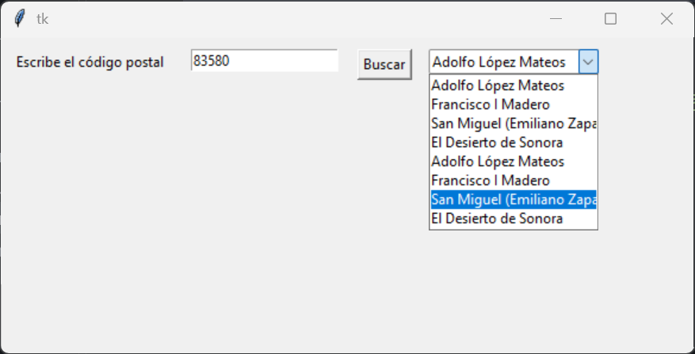
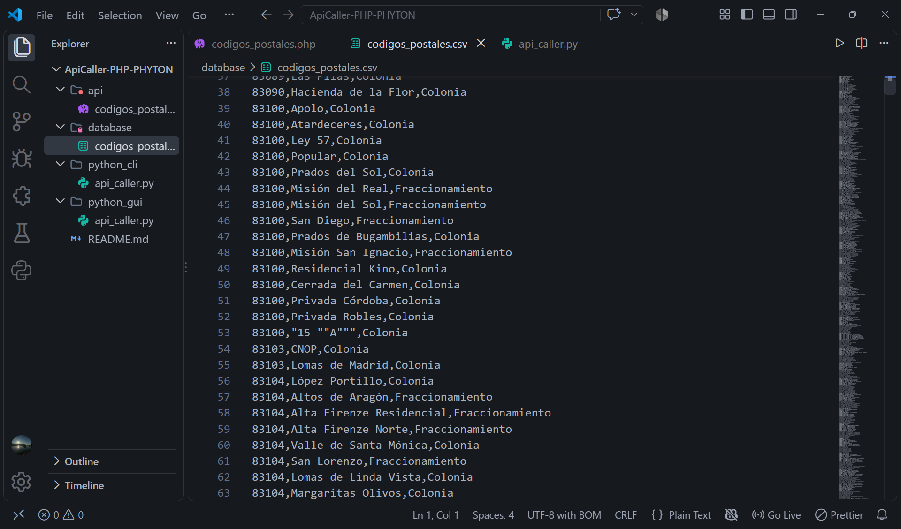
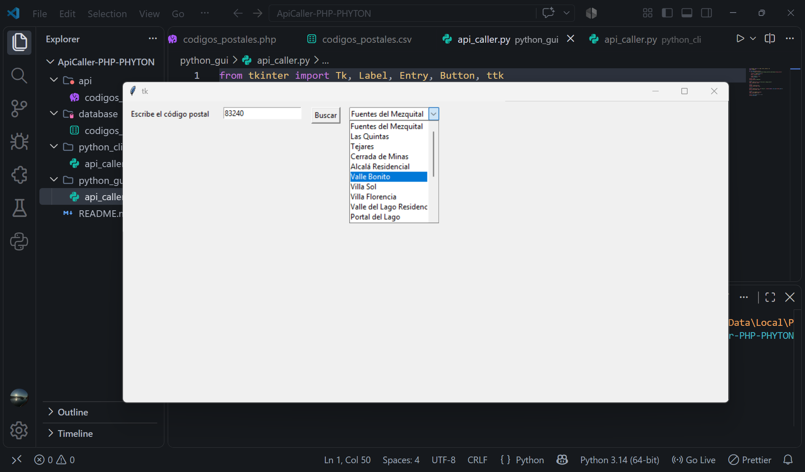
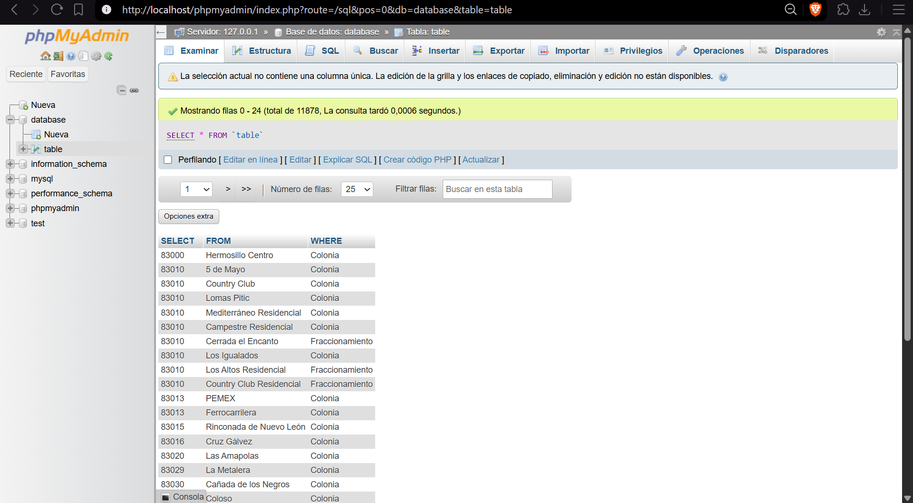
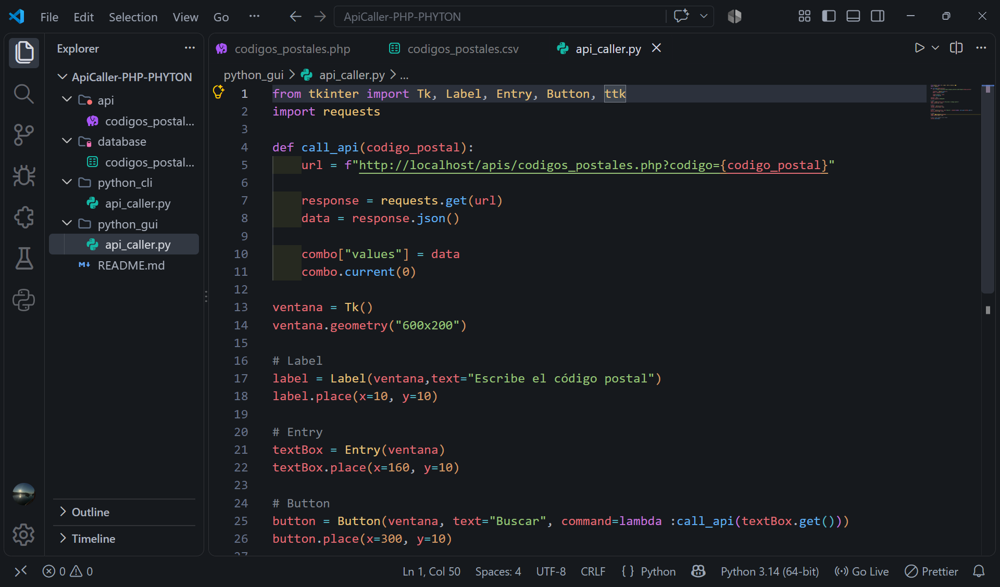
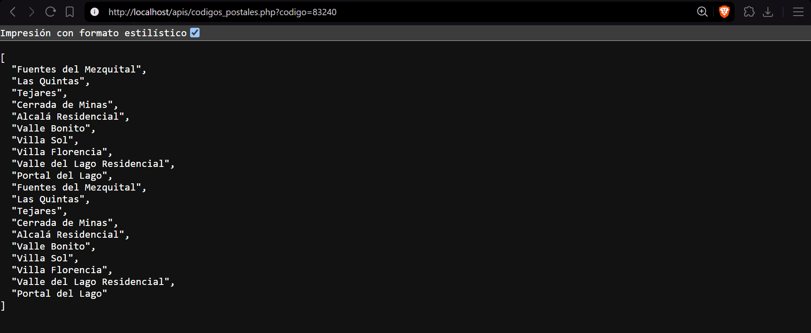
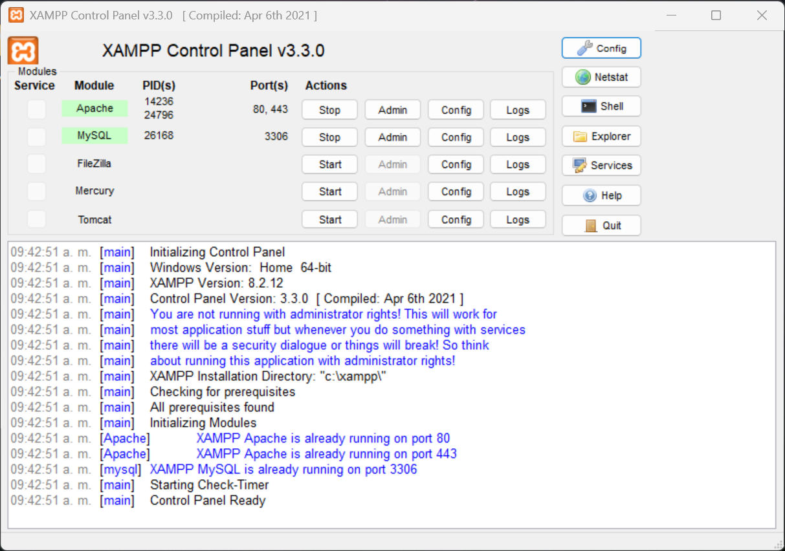

# API Caller con PHP y Python

## Creador

- **[Antuan Carpio]** – GitHub: [@antuancarpio](https://github.com/antuancarpio)

## Descripción

Api Caller con PHP y Python para consultar las colonias de una ciudad por código postal de un archivo CSV simulando una tabla con los datos, recibiendo un JSON con la información. Se compone de dos partes:

- **API en PHP:** recibe un código postal, busca en una base de datos MySQL (cargada desde un archivo CSV) y responde con la lista de colonias en formato JSON.
- **Cliente en Python:** hace una petición HTTP a la API y muestra las colonias encontradas. Hay dos versiones: una de **consola** y una con **interfaz gráfica** (Tkinter) que muestra las colonias en un menú desplegable.

### ¿Cómo se usa?

- **Versión de consola:** escribe el código postal cuando el programa lo pida y presiona `Enter`. Se imprimen las colonias en la terminal.
- **Versión gráfica:**
  - Escribe el código postal en la caja de texto (por ejemplo `83240`).
  - Presiona el botón **Buscar**.
  - Elige una colonia en el menú desplegable.
- **Mensajes de la API:** si no se envía el código postal, la API responde con un error. Si el código no existe, la lista llega vacía.

## Tecnologías

- PHP
- MySQL
- Apache (XAMPP)
- Python (`requests` y `tkinter`)
- JSON


## Instrucciones de uso

### Requisitos

- [XAMPP](https://www.apachefriends.org) (incluye Apache y MySQL)
- [Python 3](https://www.python.org/downloads/) (al instalarlo, marca la casilla **Add python.exe to PATH**)

### Paso 1: Descargar el proyecto

Descárgalo o clónalo con Git

### Paso 2: Encender XAMPP

1. Abre el **XAMPP Control Panel**.
2. Da clic en **Start** en **Apache** y en **MySQL**. Los dos deben ponerse en verde.

### Paso 3: Copiar la API a XAMPP

Copia el archivo `api/codigos_postales.php` a esta ruta:

```
C:\xampp\htdocs\apis\codigos_postales.php
```

(Si la carpeta `apis` no existe, créala.)

### Paso 4: Crear la base de datos

1. Abre `http://localhost/phpmyadmin` en tu navegador.
2. Crea una base de datos nueva.
3. Entra a ella, ve a la pestaña **Importar** y elige el archivo `database/codigos_postales.csv`.
4. En formato selecciona **CSV** y en el juego de caracteres **utf8**. Da clic en **Importar**.

### Paso 5: Ajustar el PHP

Abre `codigos_postales.php` y cambia el nombre de la base de datos, de la tabla y de las columnas por los que tengas en phpMyAdmin.

### Paso 6: Probar la API

Con Apache y MySQL encendidos, abre en el navegador:

```
http://localhost/apis/codigos_postales.php?codigo=83240
```

Debe mostrar una lista en JSON con las colonias de ese código postal.

### Paso 7: Instalar la librería de Python

```bash
pip install -r requirements.txt
```

### Paso 8: Ejecutar el cliente

Versión de consola:

```bash
python python_cli/api_caller.py
```

Versión gráfica:

```bash
python python_gui/api_caller.py
```

## Imágenes







